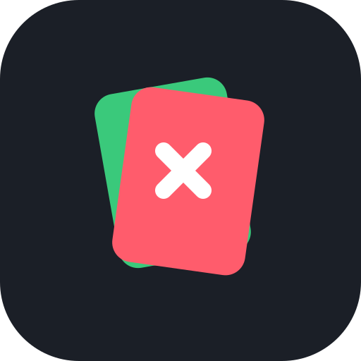

<p align="center">
  
</p>

<h1 align="center">Purgr</h1>
<p align="center"><b>Swipe your gallery clean.</b><br/><i>Right to keep, left to delete. Nothing is gone until you say so.</i></p>

Purgr is a calm, minimalist Android app that turns cleaning up your photos and
videos into a Tinder-style swipe. Swipes only *mark* things; deleting happens
once, at the end of a session, after you've had a chance to change your mind.

## Design

* Dark, neutral surfaces with two signal colours: **green** to keep, **red** to delete.
* A big card for the current photo or video, with the next one peeking out behind it.
* **KEEP** / **DELETE** stamps fade in as you drag, so you always know what a release will do.

## Features

**Swiping**

| | |
|---|---|
| 👉 **Swipe right** | Keep it. It won't show up again |
| 👈 **Swipe left** | Mark it for deletion (nothing is deleted yet) |
| ✕ / ✓ buttons | The same thing, one-handed |
| ↩️ **Undo** | Takes back your last swipe |
| ▶️ **Videos** | Shown with a play icon and length; tap to play in your video app |

**Safe deletion**

* 🧺 **Delete per session, not per swipe.** Left-swipes pile up in a *Review* list.
* 🔎 **Review screen**: a grid of everything you marked, with the total size you'll
  free up. Tap anything to **rescue** it, then confirm.
* 🗑️ **Moved to Trash, not erased.** Confirmed items go to Android's system trash
  (restorable for ~30 days).
* ♻️ **Trash screen** (bin icon, top right): see everything that was deleted, then
  **restore** it or **delete forever**. Accidentally swiped the wrong photo? It's here.
* 💾 Decisions are remembered between launches, so a half-finished session isn't
  lost. **Start over** resets everything.

## Building

Requirements: JDK 17+ and the Android SDK (API 35). Open the project in
Android Studio, or:

```bash
./gradlew assembleDebug
# APK: app/build/outputs/apk/debug/app-debug.apk
```

### Download

Every push to `main` builds the app and publishes the APK on the
[**Releases**](../../releases/latest) page. Download `Purgr-1.0.N.apk` and
open it on your phone (allow installing from your browser or files app if asked).
New versions install over old ones and keep your decisions.

Release APKs are signed with `keystore/purgr-release.jks`. That key is committed
to the repo so updates always install cleanly, which also means it is **not
secret**. Before publishing to a store, use your own key by setting
`PURGR_KEYSTORE`, `PURGR_KEYSTORE_PASSWORD`, `PURGR_KEY_ALIAS` and
`PURGR_KEY_PASSWORD`.

Requires **Android 11 or newer** (the restorable trash uses `MediaStore.createTrashRequest`).

### Permissions

| Permission | Why |
|---|---|
| Photos & videos (`READ_MEDIA_IMAGES` / `READ_MEDIA_VIDEO`, or `READ_EXTERNAL_STORAGE` on Android 11–12) | To show your gallery |

Purgr has no internet permission and never uploads anything. Moving items to the
trash or deleting them is confirmed through Android's own system dialog.

## Project layout

```
app/src/main/java/com/purgr/app/
├── MediaRepository.kt   MediaStore queries, trash / restore / delete requests
├── DecisionStore.kt     Remembers kept and marked items between launches
├── PurgrViewModel.kt    Session state: queue, marked, undo, review, trash
└── ui/                  Compose screens (swipe, review, trash) and theme
branding/                Logo SVG
keystore/                Sideload signing key
```
